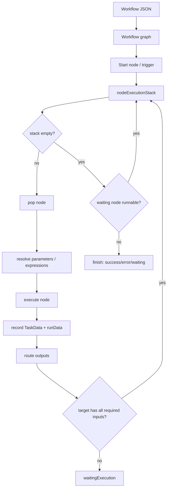
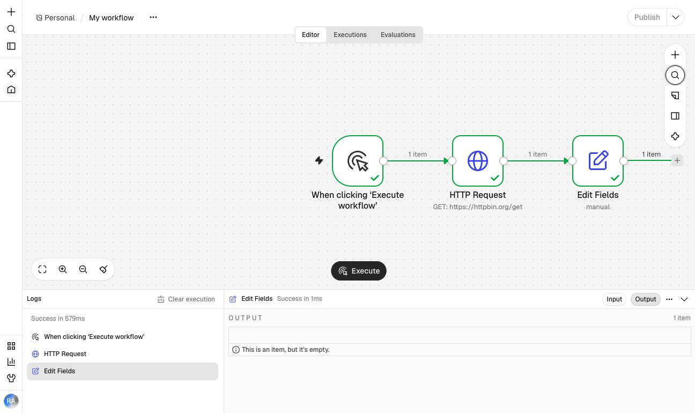
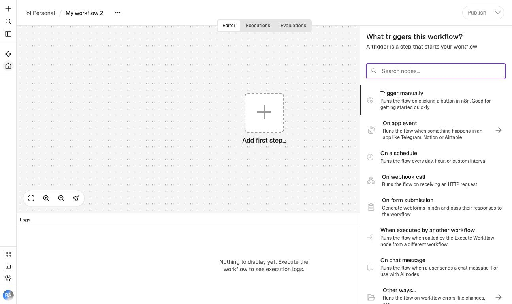
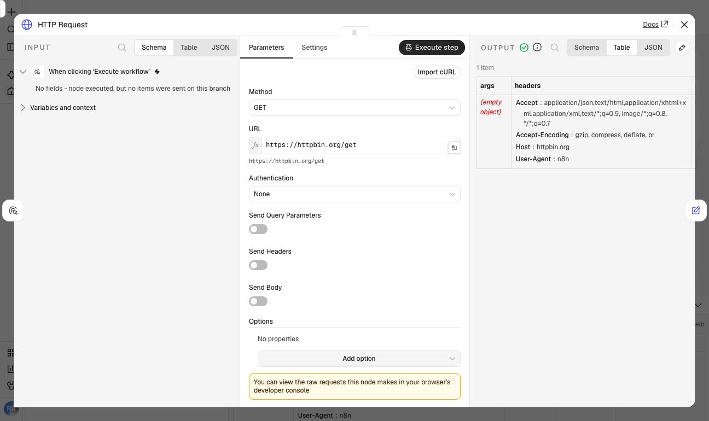
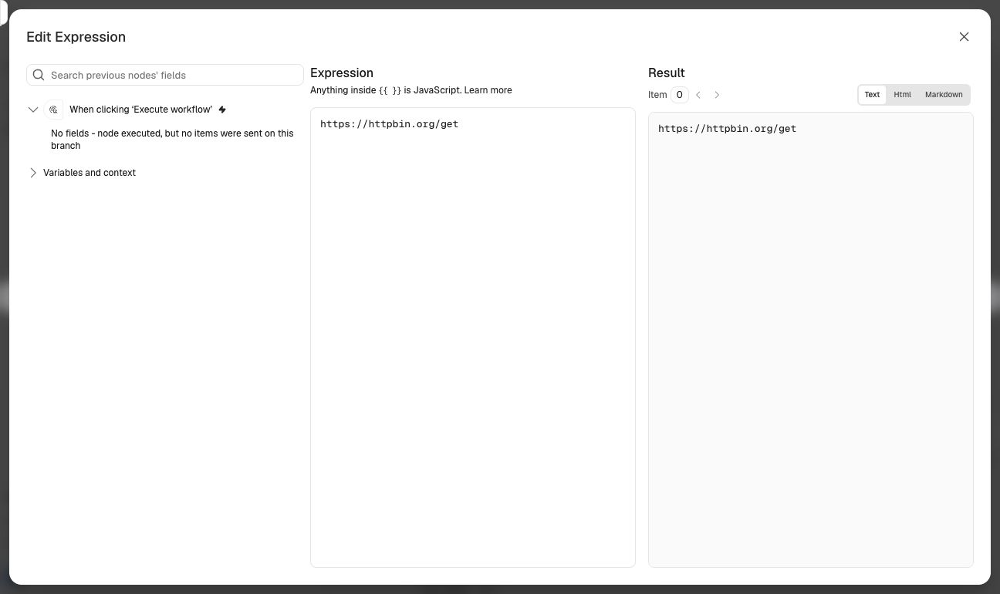
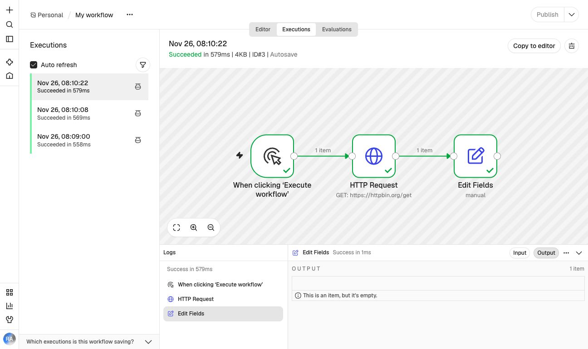

# n8n 分析レポート — 何を移植し、何を捨てるか

- 対象リポジトリ: ローカルの n8n クローン（例: `../n8n`）
- コミット: `8bef9c8156d0b225672f57da1fc096d7714e2316` (2026-11-25)
- 実機: `n8nio/n8n:latest` / n8n **2.49.6** (Docker, `localhost:5678`)
- 成果物: Docker イメージ内のビルド済みエディタを抽出し REA で静的解析
- 関連資料: [REA 証跡](./rea-evidence.md) / [Draflow 設計案](../design/draflow-design.md)

> **ライセンス上の注意**
> n8n は Sustainable Use License（fair-code）であり、OSI 承認のオープンソースではない。
> 自社内利用・非商用利用は可能だが、第三者への有償配布やホスティングサービス化には制約がある。
> 本プロジェクトでは **n8n のコードをコピーせず、観察した振る舞いと公開インターフェースを参考にクリーンルーム実装する**。
> `.ee.` を含むファイルは Enterprise License であり、参照実装に流用してはならない。

---

## 1. TL;DR

1. **n8n の製品価値は「統合ノードの数」ではなく、「実行 → データを見る → マッピング → 一部だけ再実行」という学習ループにある。** ノードライブラリは交換可能だが、このループは簡単には代替できない。
2. エディタは **ノード記述（JSON）だけ**を読み、実行はサーバー側で行う。実機では 1,004 ノードタイプ、25,556 個のパラメータ定義、18.4 MB の `nodes.json` を配信していた。
3. データの単位は **Item の配列**。各 Item は `json` / `binary` / `pairedItem` を持ち、`pairedItem` が「どの入力 Item から生まれたか」の系譜を保証する。
4. 実行は **スタック + waiting（未完の入力待ち）+ runData** で構成される。UI のキャンバス、ログ、データパネルはすべて `runData` の射影である。
5. 式は **フル JavaScript + データプロキシ + Luxon 拡張**。強力だが、sandbox・VM・依存が重く、組み込み先の CSP と相性が悪い。
6. UX の核心は **3ペイン NDV（Input / Parameters / Output）**、**ドラッグ&ドロップのデータマッピング**、**ピン留め**、**ステップ実行**、**ノード単位のログ**。
7. キャンバスは Vue Flow 依存。Tidy Up は dagre 依存。Draflow では **ゼロ依存の自前キャンバス**が必要。
8. n8n 全体は巨大。editor-ui 約 107 万行、CLI 約 127 万行、エディタ成果物 33 MB（JS 23.6 MB）。
9. 移植すべきは **コアの約 10%**。統合 1,000 個、AI、フォーム、評価、RBAC、SSO、ワーカー、テンプレート、履歴は捨てる。
10. Draflow の勝ち筋は **軽量・高速・ゼロ依存・埋め込み可能**。n8n の「操作の気持ちよさ」を、1/100 のサイズで再現する。

---

## 2. n8n の製品構造

### 2.1 用語

| 用語 | 意味 |
| --- | --- |
| Workflow | ノードと接続のグラフ。JSON で保存される |
| Node | 処理の単位。`type` + `typeVersion` + `parameters` を持つ |
| Connection | ノード間の有向エッジ。`main` などのポート種別と入出力 index を持つ |
| Item | データの単位。`{ json, binary?, pairedItem? }` |
| RunData | 実行後のノード別結果。UI の表示元 |
| Execution | 1 回のワークフロー実行。成功/失敗/待機/キャンセルを持つ |
| Credential | 認証情報。ノードは ID で参照し、ホストが復号する |
| Trigger | 実行の起点。manual / schedule / webhook / poll / app event |
| NDV | Node Details View。ノード設定と入出力を見る 3 ペイン画面 |
| Node Creator | ノード追加パネル。検索・カテゴリ・アクション選択 |
| Pin | ノードの出力を固定し、上流を実行せずに下流をテストする |

### 2.2 画面構成

実機で確認した主要画面:

1. **Workflow Editor**: キャンバス + 上部ツールバー + 下部 Logs + 右側 Node Creator。
2. **NDV**: 画面全体を覆う 3 ペイン。Input / Parameters+Settings / Output。
3. **Executions**: 左に実行一覧、右に読み取り専用キャンバス + Logs。
4. **Command Palette**: ノード・ワークフロー・認証・設定・操作を横断検索。
5. **Node Creator**: トリガー選択 → カテゴリ → アプリのアクション、の 3 段階。

### 2.3 基本操作フロー

```text
新しいワークフロー
  → 「何がこのワークフローを起動するか」を選択
  → ノードの + を押して「次に何が起きるか」を選択
  → NDV でパラメータを設定
  → Execute step で 1 ノードだけ実行
  → Input / Output を見て、フィールドをドラッグしてマッピング
  → Execute workflow で全体実行
  → Logs でノードごとの入出力と時間を確認
  → Publish（有効化）で本番トリガーを登録
```

この順序自体が UX の設計である。n8n は「設定項目を埋めさせる」のではなく、**常に小さく実行して結果を見せる**。

---

## 3. データモデル

### 3.1 Workflow JSON（実機から取得した実例を要約）

```json
{
  "id": "s3QPeYjymgMFgqNv",
  "name": "My workflow",
  "active": false,
  "nodes": [
    {
      "parameters": {},
      "type": "n8n-nodes-base.manualTrigger",
      "typeVersion": 1,
      "position": [0, 0],
      "id": "8ba04f10-...",
      "name": "When clicking ‘Execute workflow’"
    },
    {
      "parameters": { "url": "=https://httpbin.org/get", "options": {} },
      "type": "n8n-nodes-base.httpRequest",
      "typeVersion": 4.5,
      "position": [224, 0],
      "id": "d8cff09f-...",
      "name": "HTTP Request"
    },
    {
      "parameters": { "options": {} },
      "type": "n8n-nodes-base.set",
      "typeVersion": 3.5,
      "position": [448, 0],
      "id": "4b39e5c7-...",
      "name": "Edit Fields"
    }
  ],
  "connections": {
    "When clicking ‘Execute workflow’": {
      "main": [[{ "node": "HTTP Request", "type": "main", "index": 0 }]]
    },
    "HTTP Request": {
      "main": [[{ "node": "Edit Fields", "type": "main", "index": 0 }]]
    }
  },
  "settings": { "executionOrder": "v1", "binaryMode": "separate" },
  "pinData": {},
  "nodeGroups": []
}
```

出典: `packages/workflow/src/interfaces.ts` の `IWorkflowBase`（L3874）、`INode`（L1847）、`IConnections`（L543）。

**注目点**

- 接続のキーは **ノード名**。ノード名を変更すると、接続と式の参照を書き換える必要がある。
- `connections[node][portType][outputIndex]` は配列。1 つの出力から複数ノードへ分岐できる。
- パラメータ値の先頭 `=` は「式モード」を意味する。`"=https://..."` は式モードで固定文字列、`"={{ $json.url }}"` は式。
- `pinData` はノード名 → Item 配列。実行時は pin されたノードの出力を固定値として使う。
- `settings.executionOrder: "v1"` は「左上のノードから実行する」現行順序。

### 3.2 Item とデータの流れ

`packages/workflow/src/interfaces.ts` L1961 付近で定義される Item の概念を要約する:

| フィールド | 意味 |
| --- | --- |
| `json` | ノードが扱う JSON 本体 |
| `binary` | バイナリ参照（ストレージ ID + MIME + ファイル名） |
| `error` | エラー Item の場合の例外オブジェクト |
| `pairedItem` | どの入力 Item から派生したかの系譜（Item 番号 + 入力ポート） |
| `metadata` | サブ実行など補助情報 |
| `sendMessage` | チャット系ノードが UI に送るメッセージ |

- ノードは **Item の配列**を受け取り、**Item の配列の配列（出力ポートごと）**を返す。
- エンジンが入力時に `pairedItem` を自動付与する（`addPairedItemLineage`）。これにより「この出力はどの入力から来たか」を辿れる。
- `binary` はファイル参照（ストレージ上の ID とメタデータ）。実行データには実体を入れない。
- エラー Item は `error` と `json.error` の両方に現れる（`normalizeNodeErrors`）。

### 3.3 RunData

`packages/workflow/src/interfaces.ts` L3793 付近の TaskData の概念を要約する:

| フィールド | 意味 |
| --- | --- |
| `startTime` / `executionTime` | 開始時刻と所要時間（ms） |
| `executionIndex` | 実行全体での通し番号 |
| `source` | どの上流ノードのどの出力から来たか |
| `executionStatus` | `success` / `error` / `waiting` / `canceled` |
| `data` | 出力ポートごとの Item 配列 |
| `inputOverride` | UI 表示用の入力上書き |
| `error` | 失敗時のシリアライズ済みエラー |
| `hints` | ノードが UI に出す補足メッセージ |

`resultData.runData[nodeName][runIndex]` に実行結果が積まれる。UI のキャンバス状態、ノードのバッジ、Logs の表、NDV の Input/Output は、すべてこの 1 つの構造から描画される。

### 3.4 実行データの保存形式

実行レコードは `IRunExecutionData`（version 1）として保存される（`packages/workflow/src/run-execution-data/run-execution-data.v1.ts`）。

```ts
{
  version: 1,
  startData?: { startNodes?, destinationNode?, runNodeFilter? },
  resultData: {
    error?, runData, pinData?, lastNodeExecuted?, failedBeforeStart?
  },
  executionData?: {
    contextData, runtimeData, nodeExecutionStack,
    metadata, waitingExecution, waitingExecutionSource
  },
  waitTill?, resumeToken?, parentExecution?
}
```

実機の REST レスポンスでは、この JSON が **flatted**（参照文字列で循環を圧縮）形式で保存されていた。Draflow では循環を含まない設計にし、通常の JSON で保存する。

---

## 4. 実行エンジン

### 4.1 全体像



出典: `packages/core/src/execution-engine/workflow-execute.ts` の `processRunExecutionData`（L2480〜）。

### 4.2 ループの実装（要約）

```ts
while (stack.notEmpty()) {
  if (shouldStop()) break;

  const entry = stack.shift();
  const node = entry.node;

  if (nodeFilter && !nodeFilter.has(node.name)) continue;

  ensureInputData(...);
  const task = createTaskStartedData(entry);
  await hooks.nodeExecuteBefore(node.name, task);

  let output;
  for (let tryIndex = 0; tryIndex < maxTries; tryIndex++) {
    try {
      output = await runNode(workflow, entry, runData, runIndex, ...);
      break;
    } catch (error) {
      executionError = reportNodeExecutionError(error, node, workflow);
    }
  }

  const taskData = createTaskData(task, entry);
  taskData.data = { main: output };

  upsertTaskData(node.name, runIndex, taskData);
  await hooks.nodeExecuteAfter(node.name, taskData, runExecutionData);

  routeToDownstream(node, output, runIndex);
  addWaitingNodeToEmptyStack(workflow);
}
```

### 4.3 重要なセマンティクス

| 機能 | 挙動 | 実装 |
| --- | --- | --- |
| Disabled | ノードをスキップ。入力は下流に通過 | `handleDisabledNode` |
| Execute Once | 最初の Item だけで実行 | `handleExecuteOnce` |
| Always Output Data | 出力が空でも `{}` を 1 Item 出す | `ensureAlwaysOutputData` |
| Retry On Fail | `maxTries`（2〜5、既定 3）、`waitBetweenTries`（0〜5000ms、既定 1000） | `getRetryParams` |
| On Error: Stop | 実行を停止し、ノードをスタックに戻す | `handleNodeExecutionError` |
| On Error: Continue | 入力 Item をそのまま下流へ流す | 同上 |
| On Error: Error Output | エラー Item を別出力へ流す | `handleNodeErrorOutput` |
| Pin Data | pin されたノードは実行せず固定出力を使う。runIndex 0 のみ | `getPinnedOutput` |
| Waiting | 複数入力ノードは全入力が揃うまで `waitingExecution` で待つ | `addWaitingNodeToEmptyStack` |
| Run Index | 同一ノードの実行回数。ループや複数回実行を区別 | `computeRunIndex` |
| Cycle Guard | 同じ `node:runIndex` が連続したら無限ループとして停止 | `currentExecutionTry` |
| Timeout | 実行全体のタイムアウトでキャンセル | `hasExecutionTimedOut` |
| Cancellation | `PCancelable` と `AbortController` で中断 | `setupCancellation` |

### 4.4 部分実行（Partial Execution）

`runPartialWorkflow2`（L272〜）は、指定した destination node までを実行する。

1. destination の親を辿り、実行対象のサブグラフを作る。
2. 既存の `runData` のうち、変更されていない上流は再利用する。
3. `dirtyNodeNames` に該当するノードとその下流だけを再実行する。
4. `startNodes` を再構築してスタックに積む。
5. サイクルを検出・処理する。

UI の「Execute step」「Execute previous nodes」「Copy to editor」はこの仕組みに乗っている。

### 4.5 実行モード

`packages/workflow/src/execution-context.ts` L118:

```
cli | error | integrated | internal | manual | retry | trigger | webhook | evaluation | chat | agent
```

Draflow では `manual | trigger | webhook | retry | subworkflow` 程度に絞る。

---

## 5. ノードシステム

### 5.1 記述（Description）と実行（Execute）の分離

`packages/workflow/src/interfaces.ts` L2708 付近。エディタと実行器の接点は、おおまかに次の責務に分かれる:

| メンバー | 責務 |
| --- | --- |
| `description` | エディタが読むメタデータ（名前、入出力、パラメータ、認証、Webhook 定義） |
| `execute` | 通常ノードの処理。Item 配列を受け取り、出力ポートごとの Item 配列を返す |
| `trigger` | 常駐型トリガーの起動。停止関数を持つハンドルを返す |
| `webhook` | HTTP リクエストを処理し、ワークフロー入力またはレスポンスを返す |
| `poll` | 一定間隔で外部を確認し、新規データがあれば Item を返す |
| `supplyData` | AI 系のサブノードにデータを供給する（v1 対象外） |
| `methods` | 動的選択肢、検索、認証テスト、リソースマッピングなどの補助関数 |

エディタが必要とするのは `description` だけ。実行コードはサーバーに残る。この分離により、1,000 ノードをエディタに載せても JS バンドルは増えない（代わりに 18.4 MB の JSON を配る）。

### 5.2 ノード記述の形

`INodeTypeDescription`（L3267）の主なフィールド:

| フィールド | 意味 |
| --- | --- |
| `displayName` / `name` | 表示名 / 一意な型名 |
| `version` | 対応バージョンの配列 |
| `group` | `trigger` / `transform` / `output` などの分類 |
| `inputs` / `outputs` | ポート定義。型名の配列、または詳細設定 |
| `properties` | パラメータ定義の配列 |
| `credentials` | 必要な認証情報のスロット |
| `defaults` | ノード追加時の既定値（名前など） |
| `requestDefaults` | 宣言的 HTTP の既定リクエスト |
| `webhooks` | 宣言的 Webhook の定義 |
| `polling` | ポーリング型トリガーか |
| `hints` | エディタに出す補足・警告 |

### 5.3 パラメータ型

`NodePropertyTypes`（L2047）の全種:

```
boolean, button, collection, color, dateTime, fixedCollection, hidden,
icon, json, callout, notice, multiOptions, number, options, string,
credentialsSelect, resourceLocator, curlImport, resourceMapper,
filter, assignmentCollection, credentials, sqlEditor, ...
```

Draflow で移植するのは **12 種類程度**:

| 型 | 用途 | 優先度 |
| --- | --- | --- |
| `string` / `text` | 1 行 / 複数行 | 必須 |
| `number` / `boolean` | 数値 / 真偽 | 必須 |
| `select` / `multiSelect` | 選択肢 | 必須 |
| `json` | JSON エディタ | 必須 |
| `collection` | 折りたたみ可能な任意項目 | 必須 |
| `fixedCollection` | 繰り返し可能な項目グループ | 必須 |
| `resourceLocator` | ID / URL / リストから選ぶ複合入力 | 推奨 |
| `notice` / `callout` | 説明・警告 | 推奨 |
| `hidden` | 内部用 | 必須 |
| `code` | コード入力（ホスト提供） | 任意 |

### 5.4 表示条件（displayOptions）

`packages/workflow/src/node-helpers.ts` L341 の `checkConditions` が中核。

```json
{
  "displayOptions": {
    "show": {
      "resource": ["message"],
      "operation": ["send"],
      "authentication": ["oAuth2"]
    }
  }
}
```

条件式は `eq / not / gte / lte / gt / lt / between / includes / startsWith / endsWith / regex / exists` をサポートし、`@version` `@tool` `@feature` も参照できる。

**UX への影響**: ノード設定画面は「全パラメータを並べる」のではなく、**選択に応じて動的に組み替わるフォーム**である。この仕組みが n8n のノードを「アプリらしく」見せている。

### 5.5 バージョニング

- `version` は配列。ノードは `typeVersion` を持つ。
- エディタは `getByNameAndVersion(type, typeVersion)` で記述を解決する。
- 既存ワークフローは古いバージョンのまま動く。アップグレードは明示的に行う。
- Draflow でも `typeVersion` を最初から持たせる。これは後方互換の生命線。

### 5.6 宣言的 HTTP（RoutingNode）

`packages/core/src/execution-engine/routing-node.ts`（1,299 行）は、`requestDefaults` / `requestOperations` / `routing` から HTTP リクエストを組み立てる。

- 認証（Basic / Header / OAuth1 / OAuth2 / Custom）
- クエリ・ヘッダー・ボディ
- ページネーション
- レスポンスの後処理（`postReceive`）
- `loadOptions` / `listSearch` / `resourceMapping`

Draflow では **HTTP Request ノード 1 つ**に集約し、宣言的ルーティングは v2 以降でよい。

### 5.7 ノード実行コンテキスト

ノード作者が使う API（`IExecuteFunctions`、L1243〜）:

```ts
getInputData(inputIndex?, connectionType?): INodeExecutionData[];
getNodeParameter(name, itemIndex, fallback?, options?): ...;
getCredentials(type): Promise<ICredentialDataDecryptedObject>;
getWorkflowStaticData(type): IDataObject;
getNode(): INode;
getWorkflow(): IWorkflowMetadata;
getMode(): WorkflowExecuteMode;
getExecutionId(): string;
helpers.request(...);
helpers.returnJsonArray(...);
helpers.prepareBinaryData(...);
this.continueOnFail();
```

Draflow ではこれを **より小さく、型安全な Context** に置き換える（設計案参照）。

---

## 6. 式とデータマッピング

### 6.1 式の構文

- パラメータ値の先頭 `=` が式モード。
- `={{ $json.foo }}` は式全体。
- `=Hello {{ $json.name }}` は文字列補間。
- `{{ }}` が 1 つだけで前後に文字がなければ、**型を保持**する（数値・配列・オブジェクト）。
- それ以外は文字列化する。

### 6.2 データプロキシ

`packages/workflow/src/workflow-data-proxy.ts` L1748〜:

| 変数 | 意味 |
| --- | --- |
| `$json` | 現在の Item の JSON |
| `$binary` | 現在の Item のバイナリ |
| `$item` | 現在の Item 全体 |
| `$input.first()` / `.last()` / `.all()` / `.item` | 入力 Item |
| `$items(nodeName?, outputIndex?, runIndex?)` | 指定ノードの出力 |
| `$('Node Name')` | ノード参照プロキシ（`.first()` / `.all()` / `.item` / `.json`） |
| `$node["Name"].json` | 旧式のノード参照 |
| `$now` / `$today` | Luxon DateTime |
| `$vars` | ワークフロー変数 |
| `$execution` | `id`, `mode`, `resumeUrl` |
| `$workflow` | `id`, `name`, `active` |
| `$parameter` | 現在のノードのパラメータ |
| `$env` | 環境変数（ホスト提供） |
| `$runIndex` / `$itemIndex` | 実行 index |

### 6.3 拡張関数

Luxon と独自拡張により、文字列・配列・数値・日付にメソッドを生やす。

- String: `removeMarkdown`, `removeTags`, `toDate`, `toDateTime`, `format`, `toBoolean`, `toFloat`, `toInt`, `toSentenceCase`, `toSnakeCase`, `toTitleCase`, `urlEncode`, `urlDecode`, `replaceSpecialChars`, `length`, `isDomain`, `isEmail`, `isNumeric`, `isUrl`, `isEmpty`, `toJsonString`, `extractEmail`, `extractDomain`, `extractUrl`, `extractUrlPath`, `hash`, `quote`, `parseJson`, `base64Encode`, `base64Decode`, `toNumber`
- Array: `average`, `compact`, `isEmpty`, `first`, `last`, `max`, `min`, `randomItem`, `sum`, `chunk`, `difference`, `intersection`, `merge`, `pluck`, `renameKeys`, `from`, `to`, `smartJoin`, `union`, `unique`, `append`
- Object: `isEmpty`, `compact`, `urlEncode`, `hasField`, `removeField`, `removeFieldsContaining`, `keepFieldsContaining`, `keys`, `values`, `toJsonString`
- Number: `ceil`, `floor`, `isEven`, `isOdd`, `format`, `round`, `toBoolean`, `toDateTime`, `abs`, `isInteger`
- Date: `endOfMonth`, `isDst`, `isWeekend`, `beginningOf`, `extract`, `format`, `isBetween`, `isInLast`, `minus`, `plus`, `diffTo`, `diffToNow`
- Boolean: `toNumber`

### 6.4 評価と sandbox

- `@n8n/tournament`（AST ベースの式評価）と `@n8n/expression-runtime`（QuickJS ベースの sandbox）を併用。
- `Expression` クラス（`packages/workflow/src/expression.ts`）が構文変換、エラークラス、タイムアウト、メモリ制限、ホストコール制限を管理。
- フロントエンドでも式のプレビューを実行するため、評価器が二重に存在する。
- 結果として、**依存と責務が大きい**。組み込み先の CSP で `unsafe-eval` が禁止されていると動かない。

### 6.5 マッピングの生成

`packages/frontend/editor-ui/src/app/utils/mappingUtils.ts` L24〜:

- 直前のノードからなら `{{ $json.field }}`
- 離れたノードからなら `{{ $('Node Name').item.json.field }}`
- キーに空白があるなら `{{ $json["Readable date"] }}`
- 既存値が式なら追記、プレーンテキストなら `=text {{ ... }}`、空なら `={{ ... }}`
- `requiresDataPath` のパラメータは式ではなく **パス文字列**だけを入れる（URL など）

このロジックは小さく、UX への影響が大きい。Draflow でも同じ挙動を実装する。

---

## 7. トリガーと実行の起動

### 7.1 3 種類のトリガー

| 種類 | 実装 | 起動 |
| --- | --- | --- |
| Trigger function | `trigger()` が `ITriggerResponse` を返す | 常駐プロセスがイベントを待つ |
| Poll | `poll()` を cron で呼ぶ | スケジューラ |
| Webhook | `webhook()` + `webhookMethods` | HTTP リクエスト |

`packages/core/src/execution-engine/active-workflow-triggers.ts` L159 の `addTriggers`:

1. workflow から trigger node / poll node を抽出
2. trigger function を起動し、`ITriggerResponse` を保存
3. poll node をスケジューラに登録
4. 失敗時は部分的に起動したトリガーをロールバック
5. Webhook は `webhook_entity` テーブルに登録し、WebhookServer がルーティング

### 7.2 Webhook のレスポンスモード

`packages/workflow/src/interfaces.ts` L3513:

```
onReceived | lastNode | responseNode | formPage | hostedChat | streaming
```

- `onReceived`: 受信即返す
- `lastNode`: 最後のノードまで実行して返す
- `responseNode`: Respond to Webhook ノードで明示的に返す
- `formPage` / `hostedChat` / `streaming`: 特殊用途

Draflow では `onReceived | lastNode | responseNode` の 3 つに絞る。

### 7.3 テスト URL と本番 URL

n8n はワークフロー公開前でも Webhook を試せるよう、テスト用 URL を別に登録する。UI の「Listen for test event」はこれを使う。Draflow でも **テスト実行用の一時 Webhook** を用意すると体験が大きく向上する。

---

## 8. UX ディテール

### 8.1 キャンバス



実機観察:

- ノードは角丸カード。中央にアイコン、下に名前、その下に設定の要約（例: `GET: https://httpbin.org/get`）。
- 実行成功で緑の枠とチェック、失敗でオレンジの枠と警告アイコン。
- 接続線の上に `1 item` などの件数バッジ。
- ノードの右に `+` ハンドル。クリックで Node Creator が開く。
- ノードにホバーすると、上部に `Execute step` / `Deactivate` / `Delete` / `More actions`。
- 右上に縦並びの `+`（ノード追加）、検索、スティッキー、パネル、アシスタント。
- 左下に `Zoom to fit` / `Zoom in` / `Zoom out` / `Tidy up`。
- 下部に `Execute` ボタン。実行中は `Stop` に変わる。
- 背景はドットグリッド。実行履歴の閲覧時は斜線パターンで読み取り専用を示す。

キーボード（`Canvas.vue` L540〜）:

| キー | 動作 |
| --- | --- |
| `Enter` | 選択ノードを開く / 有効化 |
| `Ctrl/Cmd+Enter` | ワークフロー実行 |
| `Ctrl/Cmd+S` | 保存 |
| `Ctrl/Cmd+A` | 全選択 |
| `Ctrl/Cmd+C/X/V` | コピー / 切り取り / 貼り付け |
| `Ctrl/Cmd+D` | 複製 |
| `Delete` / `Backspace` | 削除 |
| `D` | 有効/無効 |
| `P` | ピン |
| `F2` | リネーム |
| `N` | ノード追加 |
| `Shift+S` | スティッキーノート |
| `Shift+Alt+T` | Tidy up |
| `Ctrl+G` / `Ctrl+Shift+G` | グループ化 / 解除 |
| `Alt+X` | サブワークフロー化 |
| `0` / `1` | ズームリセット / フィット |
| `L` / `I` / `O` | Logs / Input / Output |
| `Z` | ズームモード |
| `矢印` | 隣接ノードへ移動 |
| `Shift+矢印` | 上流/下流を選択 |

### 8.2 Node Creator



実機観察:

**トリガー選択（最初の +）**

```
What triggers this workflow?
A trigger is a step that starts your workflow

[Search nodes...]

Trigger manually
  Runs the flow on clicking a button in n8n. Good for getting started quickly
On app event
  Runs the flow when something happens in an app like Telegram, Notion or Airtable
On a schedule
  Runs the flow every day, hour, or custom interval
On webhook call
  Runs the flow on receiving an HTTP request
On form submission
  Generate webforms in n8n and pass their responses to the workflow
When executed by another workflow
  Runs the flow when called by the Execute Workflow node from a different workflow
On chat message
  Runs the flow when a user sends a chat message. For use with AI nodes
Other ways...
  Runs the flow on workflow errors, file changes, etc.
```

**通常の追加（ノードの +）**

```
What happens next?
[Search nodes...]

AI                     Build autonomous agents, summarize or search documents, etc.
Action in an app       Do something in an app or service like Google Sheets, Telegram or Notion
Data transformation    Manipulate, filter or convert data
Flow                   Branch, merge or loop the flow, etc.
Core                   Run code, make HTTP requests, set webhooks, etc.
Human review           Request approval via services like Slack and Telegram before making tool calls
Add another trigger    Triggers start your workflow. Workflows can have multiple triggers.
```

- カテゴリを選ぶと、その中の人気ノードとその他のノードが並ぶ。
- 検索はインクリメンタル。`edit fields` で即座に絞り込まれる。
- ノードを選ぶと、そのノードの `resource` / `operation` の組み合わせから **アクション一覧** を生成し、「Send message in Slack」のような具体的な行動として提示する（`useActionsGeneration.ts`）。
- 追加時、直前のノードとの接続が自動で張られる。既存の接続の途中に挿入する場合は、`source → new → target` に付け替える（`createConnectionToLastInteractedWithNode`）。

### 8.3 NDV（Node Details View）





実機観察:

```text
┌──────────────────────────────────────────────────────────────────────┐
│ [icon] HTTP Request                          Docs ↗            [x]  │
├────────────────┬──────────────────────────────┬──────────────────────┤
│ INPUT          │ Parameters | Settings        │ OUTPUT               │
│ [search]       │ [Execute step] [Import cURL] │ [search] [pin]       │
│ Schema/Table/  │ Method  [GET ▾]              │ Schema/Table/JSON    │
│ JSON           │ URL     [fx https://...  ]   │ 1 item               │
│ ▸ Node A       │ Authentication [None ▾]      │ ┌──────────────────┐ │
│   ▸ field      │ Send Query Params [toggle]   │ │ args | headers   │ │
│ ▸ Variables    │ ...                          │ │ ...              │ │
└────────────────┴──────────────────────────────┴──────────────────────┘
```

- **左**: 上流ノードの出力スキーマ。検索、Schema/Table/JSON 切替。フィールドはドラッグ可能。
- **中央**: パラメータフォーム。`Fixed | Expression` の切替。式モードでは入力欄に `fx` バッジ、下に結果プレビュー、右に拡大ボタン。
- **右**: 出力。実行前は「No output data」と `Execute step` / `set mock data`。実行後はテーブル。
- 入力がない場合は「No input data」と `Execute previous nodes`。
- 出力のピン留めアイコンで、その出力を固定できる。
- ノード名はヘッダーで直接編集できる。
- `Settings` タブに、Duplicate Item / Always Output Data / Execute Once / Retry On Fail / On Error / Notes / Display Note in Flow / ノードバージョン。

**式エディタ（モーダル）**

- 左: `Search previous nodes' fields`、上流ノードのツリー、`Variables and context`（`$now`, `$today`, `$vars`, `$execution`, `$workflow`）。
- 中央: 式。`{{ }}` が JavaScript であることの説明。
- 右: `Result`。Item 番号の切替、`Text / Html / Markdown` 表示。
- 下部: 保存/キャンセル（画面外）。

**観察された制約**: フィールド候補は「現在のノードの入力」の実行データから作られる。上流の実行データがない場合は `No fields - node executed, but no items were sent on this branch` と表示され、たとえさらに上流にデータがあっても候補が出ない。Draflow では、実行前でも **上流ノードの型定義とサンプルデータからスキーマを推定**して候補を出すことで、この体験を改善できる。

### 8.4 Logs と Executions

**Logs パネル**（`01-canvas-executed.jpg` 下部）:

- 左: `Success in 579ms` のサマリー、ノードツリー（各ノードの状態）。
- 右: 選択ノードの `Input` / `Output` / `Actions`、検索、Schema/Table/JSON、Item 数。
- 実行中はノードごとにストリーミングで更新される。



**Executions タブ**:

- 左: 実行一覧。日時、成功/失敗、実行時間。行ごとに再実行・削除。
- 右: 読み取り専用キャンバス（斜線背景）+ Logs。
- 上部: `Copy to editor`（実行データをエディタに戻す）、削除。
- `Auto refresh`、フィルタ。
- 実行の保存方針（すべて / 成功のみ / 失敗のみ / なし）はワークフロー設定。

### 8.5 Command Palette

実機観察:

- タブ: `All / Nodes / Workflows / Agents / Projects / Credentials / Data Tables / Actions`。
- Recent、Nodes、Workflow 操作（Publish / Unpublish / Execute / Tidy up）、Navigation、Help。
- キーボードだけで完結する。
- フッターに `Close Esc` / `Change type ← →`。

### 8.6 状態とマイクロコピー

- 空状態: 「Add first step…」「Nothing to display yet. Execute the workflow to see execution logs.」
- 実行成功: 緑のトースト「Workflow executed successfully」「Node executed successfully」。
- 実行失敗: ノードにオレンジの枠、エラー Item、Logs にエラー。
- ノードの要約: パラメータから生成（例: `GET: https://httpbin.org/get`, `manual`）。設定を開かなくても何をするノードか分かる。
- ツールチップ: 各パラメータの `?` に説明、ショートカットキーを表示。

---

## 9. 規模と複雑性の内訳

| 項目 | 数値 | 備考 |
| --- | ---: | --- |
| リポジトリサイズ（shallow clone） | 417 MB | `.git` 含む |
| `packages/` | 10 | `@n8n/*` は 63 |
| ノード実装ディレクトリ | 310 | `packages/nodes-base/nodes` |
| ノードタイプ記述（実機） | 1,004 | バージョン込み |
| うち AI/LangChain | 189 | 全体の約 19% |
| トリガーノード | 120 | |
| パラメータ定義の総数 | 25,556 | `/types/nodes.json` |
| `nodes.json` のサイズ | 18.4 MB | エディタが取得 |
| editor-ui の行数 | 1,069,688 | `.ts` + `.vue`、テスト含む |
| core の行数 | 74,668 | |
| workflow の行数 | 33,449 | |
| cli の行数 | 1,269,300 | |
| エディタ成果物 | 33 MB | JS 23.6 MB / 535 ファイル |
| 最大チャンク | 4.3 MB | `vendor-*.js` |
| 2 番目 | 4.0 MB | `app-*.js` |
| 3 番目 | 3.5 MB | `typescript.worker-*.js` |

**解釈**

- n8n の重さの大半は **統合ノード・AI・エンタープライズ機能・ワーカー** であり、コアの実行エンジンやエディタの本質部分ではない。
- それでも editor-ui は 100 万行超。Vue、Vue Flow、CodeMirror、Element Plus、Pinia、VueUse、i18n、テレメトリ、実験フラグ、EE 機能が積み上がっている。
- Draflow が目指すべきは「n8n の 1/100 のコードで、n8n の操作感の 80% を出す」こと。

---

## 10. 移植マトリクス

### 10.1 必ず移植する（Must）

| 機能 | 理由 |
| --- | --- |
| Item 配列 + `pairedItem` | データの流れと系譜の基礎 |
| Workflow / Node / Connection スキーマ | 保存・実行・UI の共通言語 |
| ノード記述 + `displayOptions` | 動的フォームの基礎 |
| 実行スタック + runData | 実行と UI の単一の真実 |
| Waiting / Merge の入力待ち | 分岐と合流に必須 |
| Disabled / Execute Once / Always Output Data | 実運用で必ず使う |
| Retry / On Error（3 モード） | 信頼性の基礎 |
| Pin Data | 部分テストの要 |
| 部分実行（destination / runData 再利用） | 「1 ノードだけ試す」体験の要 |
| 3 ペイン NDV | n8n の操作感の中心 |
| ドラッグ&ドロップのデータマッピング | 最大の差別化 UX |
| 式のプレビュー | マッピングの安心感 |
| Node Creator（検索 + カテゴリ + アクション） | ノード追加の体験 |
| Logs（ノード別 Input/Output/時間） | デバッグの基礎 |
| Execution 一覧 + 読み取り専用リプレイ | 運用の基礎 |
| キャンバスの状態表現（成功/失敗/実行中/件数） | 一目で状況が分かる |
| Undo / Redo / Copy / Duplicate / Delete | 編集の基礎 |
| スティッキーノート / グループ | 可読性 |
| Tidy Up | レイアウトの自動化 |
| キーボードショートカット | パワーユーザー体験 |
| コマンドパレット | 横断操作 |

### 10.2 簡略化して移植する（Should / Simplify）

| 機能 | n8n | Draflow 案 |
| --- | --- | --- |
| 式 | フル JS + sandbox + Luxon | 安全な JS サブセット + 拡張関数。ホストがフル JS 評価器を差し込める |
| 認証情報 | 内蔵 DB + 暗号化 + OAuth | ホストの `CredentialProvider`。Draflow は保存しない |
| バイナリ | ファイルストレージ + 署名 URL | `BinaryAdapter`（Blob / ArrayBuffer / URL） |
| トリガー | 常駐サーバー + queue | `RuntimeHost`（browser / node）。Webhook と cron はアダプタ |
| HTTP | RoutingNode + ページネーション + 認証 | `fetch` アダプタ + 基本認証 + ページネーションは v2 |
| ノード | 1,004 タイプ | 15〜20 タイプ |
| レイアウト | dagre | 自前の層状レイアウト（約 150 行） |
| コード編集 | CodeMirror / Monaco | textarea + 自前ハイライト + 行番号 |
| i18n | 大規模な翻訳基盤 | en / ja の小さなカタログ |
| 実行保存 | DB + 圧縮 + 保存ポリシー | `ExecutionStore` アダプタ + JSON |
| ノードバージョン | 複数バージョン並存 | `typeVersion` は保持。移行関数は v2 |
| グループ | 折りたたみ・色・ヘッダー | 矩形 + ラベル + 折りたたみ |
| 通知 | トースト + 通知センター | トーストのみ |
| テレメトリ | PostHog + Sentry | なし（ホストのフックのみ） |

### 10.3 捨てる（Won't / v1 対象外）

- 310 のアプリ統合、1,004 のノードタイプ
- AI / LangChain / Agent / Chat Hub / MCP
- Form Trigger / Form ページ
- Evaluations
- Templates / テンプレートライブラリ
- Insights / 分析
- RBAC / SSO / 監査ログ / プロジェクト
- Queue mode / Worker / Task Runner / 分散実行
- バージョン履歴 / コラボレーション / CRDT
- コミュニティノード / マーケットプレイス
- エラーワークフロー（v1 では実行結果にエラーを残すだけ）
- ワークフロー変数（`$vars` はホスト提供の読み取り専用でよい）
- 大規模 i18n / テレメトリ / 実験フラグ
- EE 機能（`.ee.`）

---

## 11. 設計原則（n8n から学ぶこと）

1. **小さく実行して見せる。** 設定画面ではなく、入力と出力を常に見せる。
2. **データを第一級にする。** ノードはコードではなく、Item を変換する関数。
3. **式は「配線」である。** フィールドをドラッグして配線できることが、プログラミング不要の体験を作る。
4. **状態は 1 か所に集約する。** `runData` がキャンバス・ログ・NDV の唯一の源。
5. **失敗を見える化する。** どのノードで、何が入り、何が出て、どこで落ちたか。
6. **部分実行を第一級にする。** 全部動かさなくても、1 ノードだけ試せる。
7. **固定（Pin）はテストの道具。** 上流を止めて下流を反復できる。
8. **デフォルトで動く。** トリガーを選び、ノードを足すだけで動く。
9. **設定は段階的に見せる。** `displayOptions` で、必要な項目だけを出す。
10. **ショートカットを用意する。** マウスなしで編集・実行できる。

---

## 12. リスクと注意点

### 12.1 ライセンス

- n8n は Sustainable Use License。**コードのコピーは不可**。
- API 名、JSON 形状、UX パターンはアイデアであり、著作権の保護対象外となり得るが、表現のコピーは避ける。
- `.ee.` ファイルは Enterprise License。参照しない。
- 商標（n8n）を使用しない。UI の見た目をそのまま複製しない。

### 12.2 セキュリティ

- **式の eval** は最大のリスク。Draflow はデフォルトで eval しない。
- **Code ノード** はホストの明示的なオプトイン。ブラウザでは CSP と sandbox iframe を推奨。
- **SSRF**: HTTP ノードはホストの `fetch` アダプタ経由にし、許可リスト・プライベート IP 制限をホストに委ねる。
- **資格情報**: Draflow は保存しない。ホストの秘密管理に委ねる。
- **Webhook**: 署名検証・レート制限・ボディサイズ制限はホストの責務。
- **XSS**: ノード名・パラメータ・実行データはすべて信頼できない入力として扱い、`textContent` で描画する。

### 12.3 ブラウザの制約

- CORS: 任意の API をブラウザから直接叩けない。ホストのプロキシ `fetch` を前提にする。
- 常駐実行: ブラウザは閉じると止まる。本番トリガーは Node ランタイムが必要。
- タイマー: バックグラウンドタブで間引かれる。スケジュールはサーバー推奨。
- ストレージ: localStorage は 5 MB 程度。大きい実行データは IndexedDB かホスト API。

### 12.4 スケール

- n8n は数百万 Item を想定するが、Draflow は **1 実行あたり 10,000 Item** を上限の目安にする。
- データテーブルは 100 行ずつページング / 仮想化。
- 実行データはサイズ上限と保持件数を持つ。

### 12.5 アクセシビリティ

- キャンバスはキーボードで全ノードに到達できるようにする。
- NDV はフォーカストラップ、Esc で閉じる、復帰先を保持。
- 色だけで状態を伝えない（アイコン + テキスト）。
- `prefers-reduced-motion` を尊重。

---

## 13. 付録: 参照ファイル

| 領域 | ファイル |
| --- | --- |
| Workflow / Node / Item 型 | `packages/workflow/src/interfaces.ts` |
| 実行エンジン | `packages/core/src/execution-engine/workflow-execute.ts` |
| 部分実行 | `packages/core/src/execution-engine/partial-execution-utils/` |
| ノード実行 Context | `packages/core/src/execution-engine/node-execution-context/` |
| 宣言的 HTTP | `packages/core/src/execution-engine/routing-node.ts` |
| データプロキシ | `packages/workflow/src/workflow-data-proxy.ts` |
| 式 | `packages/workflow/src/expression.ts`, `packages/workflow/src/extensions/` |
| 表示条件 | `packages/workflow/src/node-helpers.ts` |
| トリガー | `packages/core/src/execution-engine/active-workflow-triggers.ts` |
| Webhook | `packages/cli/src/webhooks/` |
| キャンバス | `packages/frontend/editor-ui/src/features/workflows/canvas/` |
| キャンバス操作 | `packages/frontend/editor-ui/src/app/composables/useCanvasOperations.ts` |
| レイアウト | `packages/frontend/editor-ui/src/features/workflows/canvas/composables/useCanvasLayout.ts` |
| NDV | `packages/frontend/editor-ui/src/features/ndv/` |
| Node Creator | `packages/frontend/editor-ui/src/features/shared/nodeCreator/` |
| マッピング | `packages/frontend/editor-ui/src/app/utils/mappingUtils.ts` |
| 実行ログ | `packages/frontend/editor-ui/src/features/execution/logs/` |
| 手動実行 API | `packages/@n8n/api-types/src/dto/workflows/manual-run.dto.ts` |

---

## 14. 結論

n8n から移植すべきは、**「実行 → 観察 → 配線 → 再実行」のループ**である。
それは、Item、runData、3 ペイン NDV、ドラッグマッピング、ピン、部分実行、ログという 7 つの部品でできている。
統合ノードの数や AI 機能は、このループの上に載る付加価値であり、最初に作るべきものではない。

Draflow は、このループを **ゼロ依存・高速・埋め込み可能** な形で再実装する。
n8n の 33 MB のエディタを、250 KB の gzip に収めることを目標にする。
